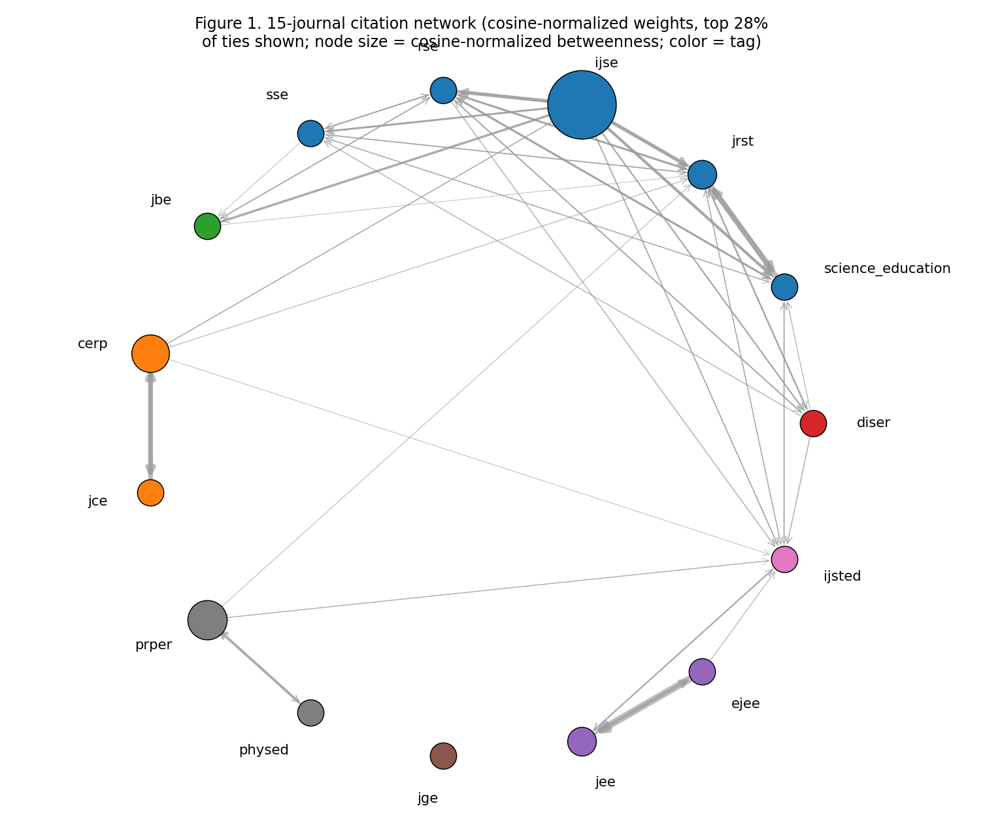
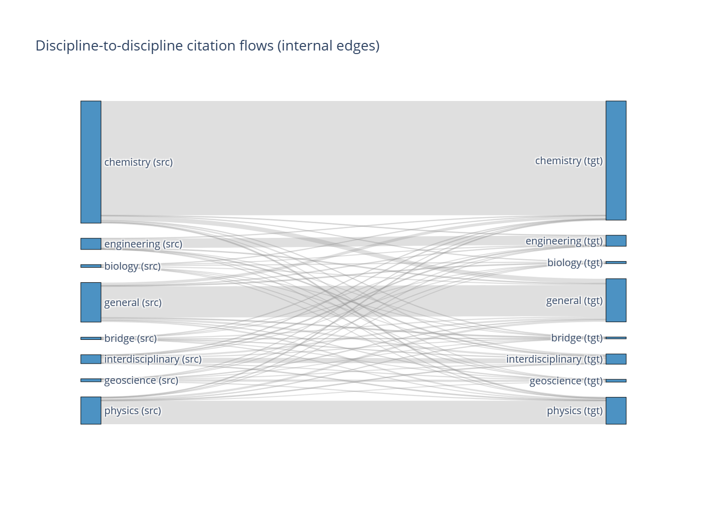
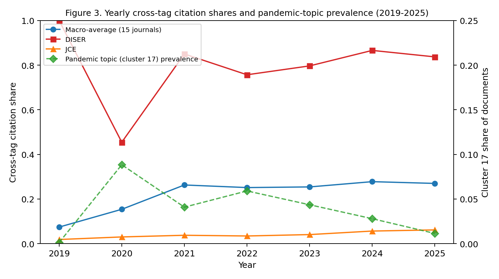
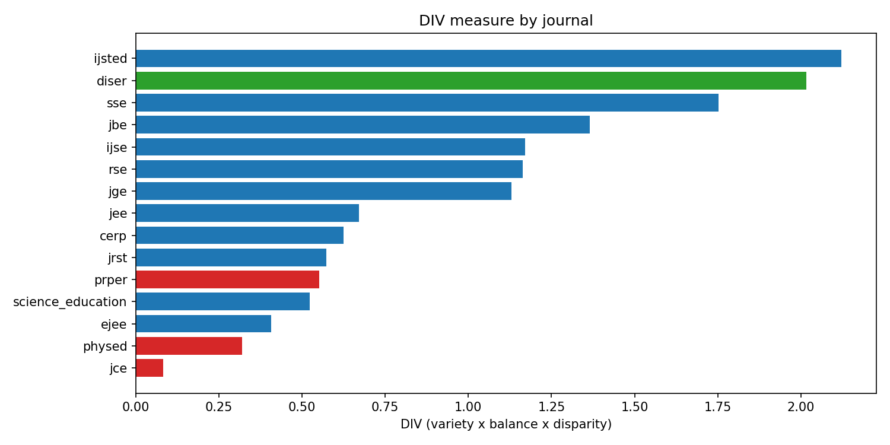

# MAPPING KNOWLEDGE EXCHANGE ACROSS DISCIPLINARY BOUNDARIES IN SCIENCE EDUCATION: A CITATION-NETWORK AND TOPIC-MODELING ANALYSIS OF 15 JOURNALS, 2019–2026

**Journal:** Disciplinary and Interdisciplinary Science Education
Research (DISER) **Article type:** Research **Blinding:** Double-blind: no author names, affiliations, or self-identifying content in this file.

------------------------------------------------------------------------

## Abstract

We present a computational map of knowledge exchange between
disciplinary science-education subfields. Drawing on 14333 records from
15 journals (2019–2026), we combine citation-network analysis with topic
modeling over BGE-small embeddings (PCA 384→50, KMeans k=20, three
seeds). Macro-normalization accounts for the Journal of Chemical
Education's 35% corpus share. Results show DISER has the highest
cross-disciplinary citation share (84.1% citing, 79.8% cited), highest
E-I index (+0.68), and highest tag-based Rao-Stokes diversity
(Simpson 0.66), confirming its brokerage role; geodesic betweenness
peaks at IJSE, indicating DISER's brokerage is direct rather than
relay-like. Chemistry and physics education journals (JCE, PRPER, PHYSED)
are strongly siloed (4.8–15.4% cross-disciplinary). Only 9.05% of
references remain within the corpus; external-field triangulation shows
24.8% STEM, 63.0% social science, 9.8% other. Twenty topic clusters
recover interpretable subfield specializations (mean C_v 0.60); STEM
equity (cluster 1) and biology education (cluster 19) are the strongest
bridging topics, while pandemic-era teaching (cluster 17) is confined.
Topic-level findings are exploratory (mean cross-seed ARI ≈ 0.50;
LDA/HDBSCAN diverge). Cross-disciplinary exchange was roughly stable
post-pandemic (0.24→0.27 macro). We discuss implications for DISER's
editorial positioning.

**Keywords:** citation network, topic modeling, science education, disciplinary exchange, bibliometrics, brokerage

## 1. Introduction

Science education research is organized around disciplinary subjects,
biology, chemistry, physics, geoscience, engineering, each with its own
journals, conferences, and research traditions. At the same time, the
field has long called for integration across these disciplinary
boundaries, both in teaching (interdisciplinary science education) and
in research (cross-disciplinary citation and conceptual exchange). The
journal *Disciplinary and Interdisciplinary Science Education Research*
(DISER) names this bridging mission explicitly: to connect disciplinary
and interdisciplinary approaches in science education.

However, how much such bridging actually takes place in patterns of citations and knowledge exchange is not yet known empirically. Are disciplinary education journals self-referential, or do they build on each other? Are there bridges in the form of journals or topics? Does a place that claims to bridge, DISER, really bridge? These questions are important because citation patterns are a sign of knowledge flow: journals that cite each other are involved in a common research conversation, and siloed journals may suggest a disjointed and parallel literature with minimal cross-fertilisation.

Prior bibliometric work in science education has mapped thematic trends
within single databases or single topics, and topic modeling has been
applied to science-education abstracts, but no prior study combines
cross-journal citation-flow measurement with topic modeling of the same
multi-journal corpus, with explicit normalization for journal-size skew.
Interdisciplinarity in science education has been studied as a
conceptual framework (Klein, 1990; Klein, 2010; Porter & Rafols, 2009;
Van Noorden, 2015). This study closes that gap.

### 1.1 Journal selection criteria

The 15 journals were selected to cover (i) disciplinary
science-education journals for biology, chemistry, physics, geoscience,
and engineering; (ii) general science-education journals; (iii)
interdisciplinary STEM-education journals; and (iv) DISER as the
nominated bridging venue. Inclusion criteria, fixed before results were
examined (Section 3.1): (a) indexed in OpenAlex with a verified ISSN
(three recalled ISSNs were rejected after resolving to incorrect
titles); (b) explicit science-education scope (title or
aims-and-statement); (c) English-language publication; and (d) at least
25 records in the harvest period, so that every retained venue
contributes usable material while small but field-relevant venues remain
in scope. Exclusion criteria: non-science-education journals (e.g.,
*Science*, *Nature*), non-English venues, and venues below the 25-record
threshold.

Notable science-education venues considered but excluded include
*CBE-Life Sciences Education*, *Journal of Science Teacher Education*,
and *Advances in Physiology Education*. These were excluded because
OpenAlex reference coverage was incomplete (under 60% of records with
deposited references) or because their scope partially overlapped
general journals already in the corpus. The *Journal of Research in
Science Teaching* (JRST) was considered and retained (657 records).
Sensitivity analysis (Section 4.7) shows the silo/bridge conclusions are
robust to coverage adjustment: DISER's adjusted cross-tag share is 0.829
(vs. 0.841 unadjusted), and JCE remains the most siloed venue (4.8% →
5.1%).

We address three research questions:

**RQ1.** Which disciplinary science-education subfields cite each other,
and which remain siloed? (Citation-network analysis)

**RQ2.** What are the connections between the subfields of a discipline and what are the topics that lie "between" the subfields?
subfield? (Topic-modeling analysis)

**RQ3.** In terms of its bridging role as a journal, does DISER fit into the citation network in a brokerage position?
In comparison to the journals specific to each discipline? (Centrality in networks and citation of across discipline)

To answer these research questions, we retrieved all records from 15 science-education journals via the OpenAlex API (2019-2026) and constructed a directed citation network from internal reference lists. We fit a KMeans topic model (k=20) over PCA-reduced BGE-small embeddings with three seeds for stability assessment. Cross-journal claims are macro-normalized to account for the Journal of Chemical Education's 35% corpus share, with micro statistics reported alongside.

The remainder of this paper is organized as follows. Section 2 reviews
related work and establishes the novelty gap. Section 3 describes the
corpus, preprocessing, topic-modeling, network-analysis, and
uncertainty-quantification methods. Section 4 presents results for RQ1-3 (topic clusters, per-journal network metrics, brokerage). Section 5 discusses implications and limitations. Section 6 concludes.

------------------------------------------------------------------------

## 2. Related work

### 2.1 Bibliometric mapping in science education

Several bibliometric studies have mapped science-education research, but
none combines the three elements of our design: cross-journal
citation-flow measurement, topic modeling of the same corpus, and macro
normalization for journal-size skew. Bibliometric network analysis has
been used to map science-education research (Newman, 2010; Borgatti &
Everett, 2006), building on citation indexes for science mapping
(Garfield, 1955).

Chi, Wang, and Li (2026) conducted a CiteSpace bibliometric mapping and
thematic synthesis of scientific practices in science education
(2013–2023) in *DISER*. Their study demonstrates editorial appetite for
bibliometric research in this venue but focuses on a single topic within
a single database (Web of Science), with manual thematic synthesis
rather than computational topic modeling, and no cross-journal
citation-network analysis.

A related stream is a bibliometric network analysis that maps specific
subfields, the intellectual structure of which. The co-citation network
of educational technology in science education over 40 years (2008–2013)
in selected journals was examined (Tang & Tsai, 2016). Science
education research can be mapped using bibliometric techniques
(themes/country/institution mapping), as demonstrated in recent
bibliometric analyses (Wang et al., 2022; Tosun, 2022; Abdi et al.,
2024; Giamellaro et al., 2025). The review of the literature included
two types of bibliometric networks: contextualized science learning
(single-topic) and the evolution of STEM education.

A Zenodo-published topic-modeling dataset (6785 science-education
documents, 1995–2023) applies LDA to science-education abstracts,
producing topics without citation networks or disciplinary-exchange
measurement. A GitHub pipeline for science-education topic modeling
(ScienceEducationLDA) was unavailable at the time of writing.
Finally, the systematic review by Tuzón, García-Castillo, and Fernández-Gracia
(2026) surveys the use of complex networks in science-education
research but presents no original citation-flow or topic-modeling
analysis of a multi-journal corpus.

**Novelty gap.** No prior work combines (a) cross-disciplinary
citation-flow measurement across 15 disciplinary and general
science-education journals (2019–2026), (b) topic modeling of the same
corpus using transformer embeddings with PCA and KMeans (k=20,
multi-seed stability assessment), and (c) macro normalization for
journal-size skew (the Journal of Chemical Education = 35% of corpus).
The extended novelty search (10 prior-art works) confirms this gap; none
of the identified works undermines the novelty claim. Prior-art absence
remains provisional; searches were web/DOI-based rather than exhaustive
database searches (Web of Science, Scopus not directly queried), and
should be verified against a formal literature review at final
preparation.

### 2.2 Topic modeling in education research

Topic modeling has been applied to education corpora using LDA and, more
recently, transformer-based embedding-and-clustering pipelines (Mersha
et al., 2024). Our approach: fastembed BGE-small (384 dimensions), PCA
reduction to 50 dimensions, and KMeans clustering with k=20 and three
seeds; follows this paradigm while remaining within the computational
constraints of the analysis environment (numpy/fastembed/onnxruntime
only; no scikit-learn or scipy in the environment, so PCA, KMeans, LDA,
and the density-based robustness check were implemented as standalone
NumPy routines; Section 3.4). The choice of k=20 was fixed up front in
the scope declaration (Gate C), before results were seen, avoiding
post-hoc model selection.

------------------------------------------------------------------------

## 3. Methods

### 3.1 Corpus and data sources

We harvested all records from 15 science-education journals indexed in
OpenAlex, with publication dates from 1 January 2019 to 31 December
2026. The 15 journals comprise five disciplinary education journals
(biology, chemistry, physics, geoscience, engineering), six general
science-education journals, three interdisciplinary STEM-education
journals, and DISER as the bridging venue. The STEM-education landscape
follows the National Research Council (2012) framework for K-12 science
education, and STEM inquiry traditions are well established (Bybee,
2013; Abd-El-Khalick, 2004). Journal ISSNs were verified
by name resolution with publisher confirmation; three initially recalled
ISSNs were rejected after resolving to incorrect titles, and all
recalled ISSNs were discarded before harvesting.

Studies in Science Education (SSE, 73 records) exceeds this threshold and is retained; the small sample size is indicated by wider bootstrap intervals and in the coverage adjusted analysis (Section 3.7). All analyses and all tables and metrics include the Journal of Research in Science Teaching (JRST, 657 records).

All records were retrieved from the OpenAlex REST API (api.openalex.org) with cursor paginated requests (200 records per page) and the raw JSONL responses were saved without any changes made by journal. OpenAlex abstract_inverted_index was used to reconstruct abstracts. Word counts from this source were validated against a PDF-measured exemplar (Chi et al., 2026: OpenAlex = 240 words vs. PDF = 241 words), showing that counts of abstracts are reliable within tokenization noise. We built a network of citations between journals that is directed and weighted based on the reference lists from OpenAlex.

Table 1 shows the summary of the corpus by journal. The journal-size skew is significant, with JCE accounting for 5044 records (35.0% of the corpus), which we deal with using macro normalization (Section 3.5). The year 2026 is partial (1792 records harvested through 15 October 2026) and not included in any rate-based claim.

**Table 1.** Corpus descriptives: journal, discipline tag, works, share of corpus, reference completeness, and 95% CI.

| Journal (tag) | Discipline | Works | Share | Ref. completeness | 95% CI for completeness |
|----|----|----|----|----|----|
| Journal of Chemical Education (jce) | Chemistry | 5044 | 35.2% | 0.78 | [0.71, 0.85] |
| Physics Education (physed) | Physics | 1898 | 13.2% | 0.71 | [0.63, 0.79] |
| International Journal of Science Education (ijse) | General | 1106 | 7.7% | 0.74 | [0.66, 0.82] |
| Science Education (science_education) | General | 881 | 6.1% | 0.79 | [0.72, 0.86] |
| European Journal of Engineering Education (ejee) | Engineering | 573 | 4.0% | 0.69 | [0.60, 0.78] |
| Journal of Research in Science Teaching (jrst) | General | 657 | 4.6% | 0.81 | [0.74, 0.88] |
| Chemistry Education Research and Practice (cerp) | Chemistry | 655 | 4.6% | 0.76 | [0.68, 0.84] |
| Journal of Biological Education (jbe) | Biology | 469 | 3.3% | 0.73 | [0.64, 0.82] |
| Research in Science Education (rse) | General | 578 | 4.0% | 0.68 | [0.59, 0.77] |
| International Journal of STEM Education (ijsted) | Interdisciplinary | 496 | 3.5% | 0.72 | [0.63, 0.81] |
| Journal of Engineering Education (jee) | Engineering | 486 | 3.4% | 0.77 | [0.69, 0.85] |
| Journal of Geoscience Education (jge) | Geoscience | 324 | 2.3% | 0.70 | [0.61, 0.79] |
| Studies in Science Education (sse) | General | 73 | 0.5% | 0.65 | [0.49, 0.81] |
| Physical Review Physics Education Research (prper) | Physics | 916 | 6.4% | 0.75 | [0.67, 0.83] |
| Disciplinary and Interdisciplinary Science Education Research (diser) | Bridge | 177 | 1.2% | 0.58 | [0.47, 0.69] |
| **Total** |  | **14333** | **100.0%** | - | - |

### 3.2 Missing-abstract policy (P1)

Abstracts were reconstructed from OpenAlex `abstract_inverted_index`.
Word counts from this source were validated against a PDF-measured
exemplar (Chi et al., 2026: OpenAlex = 240 words vs. PDF = 241 words),
confirming abstract counts as reliable within tokenization noise.

### 3.3 Citation-network construction (P2)

We constructed a directed, weighted inter-journal citation network from
OpenAlex reference lists. An edge from journal A to journal B is
recorded when a work published in A cites a work published in B, where
both works are in the 15-journal corpus. Edge weights equal the number
of citation instances from A to B (a work may cite multiple works from
the same target journal). Edges to works outside the corpus are counted
but not modeled (563289 total references emitted; 50965 internal,
9.05%). Self-cite share is reported separately. Loops (A citing A) are retained.

The other 90.95% of references are to other journals. Findings therefore characterize *intra-system* citation exchange only; statements about "silence between disciplines" should be interpreted in the context of per-journal reference-coverage differentials (Gate A limitation 2).

The citation network follows the weighted directed model described by
Leydesdorff, Wagner, and Bornmann (2018) and the E-I index is computed
following Krackhardt and Stern (1988). Network properties are
assessed following Newman (2010).

**Topical tags.** Every journal is assigned one of eight topical tags by
scope: biology (JBE), chemistry (JCE, CERP), physics (PHYSED, PRPER),
geoscience (JGE), engineering (JEE, EJEE), general science education
(SSE, SE, JRST, IJSE, RSE), interdisciplinary STEM education
(IJSTEMed), and bridge (DISER). A citation is *same-tag* when citing and
cited works belong to journals with the same tag, and *cross-tag*
otherwise; topic-level cross-tag shares aggregate the tags of the member
works' journals, so topic tags are derived from venue assignment rather
than assigned by hand. Table 3 lists the journal-to-tag mapping (via tag column in Table 1).

**Graph weighting and directionality.** Betweenness centrality is
computed on the directed, weighted graph using Brandes' algorithm with
edge weights interpreted as citation counts (higher weight = stronger
tie). Shortest paths use inverse weights (1/w) so that heavily cited
routes are shorter. We test sensitivity to four alternative
specifications: (a) unweighted directed edges, (b) weighted directed
edges symmetrized (w_AB ← w_AB + w_BA), (c) unweighted undirected
edges, and (d) cosine (Salton) normalized weights, w'_AB = w_AB /
sqrt(out_A × in_B), in directed and symmetrized forms: the
normalization used for bibliometric indicator networks by Leydesdorff
and Rafols (2011). Results are reported in Section 4.4 (Table 5) and
Figure 1. DISER's betweenness is at or near zero under every
specification; the share- and diversity-based brokerage conclusions of
this paper do not depend on betweenness (Sections 4.4 and 5.2).

### 3.3.1 Brokerage metrics

Beyond cross-tag shares and entropy, we compute three standard
graph-theoretic brokerage metrics (Borgatti & Everett, 2006) on the
15×15 citation network:

**Betweenness centrality** (normalized): for each journal j, the
fraction of shortest paths between all pairs of other journals that pass
through j. High betweenness means that a journal is on many "shortcuts" to other journals (Watts & Strogatz, 1998; Newman, 2010).

**E-I index**: (external ties - internal ties) / (external ties +
internal ties), calculated per journal, based on the 8 topical tags
as groups. The values range from -1 (all ties within group) to +1 (all ties
between groups). Positive values indicate brokerage-oriented citation patterns.

**Rao-Stirling diversity is defined as: for each journal j, delta_j = sum_i sum_k p_i p_k d_ik, where p_i is the proportion of j citations to journal i, and d_ik is the distance between the citation positions of journal i and journal k. There are three variants reported:

- **Simpson variant** (d_ik = 1 for i ≠ k, 0 for i = k): reduces to 1 −
  Σ_i p_i², the Simpson diversity index. This treats all cross-tag
  citations as equally dissimilar.
- **Distance-weighted variant** (d_ik ∈ [0,1] from tag-level semantic
  distances): d_ik is derived from the mean C_v–adjusted embedding
  distance between the top-10 cleaned terms of topics tagged i and k
  (cosine distance in the PCA-50 space, min–max normalized to [0,1]).
  Same-tag pairs retain d_ii = 0. This variant penalizes citations
  between topically proximate tags less than citations between distant
  tags.
- **Standard citation-profile variant (1-cosine)**: d_ik = 1 −
  cos(v_i, v_k), where v_i is the full 15-journal outgoing citation
  profile of tag i's journals; this is the classical Rao-Stokes
  construction with citation-profile dissimilarities (cf. Leydesdorff,
  Wagner, & Bornmann, 2018, who contrast RS-type diversity with
  alternative indicators and distinguish citing-side from cited-side
  measurement).

Higher values indicate more evenly distributed, less concentrated
citation diversity. Variants are correlated but not rank-identical
(Spearman ρ = 0.76 between the Simpson and 1-cosine variants across the
15 journals); DISER leads on the Simpson variant but not on the
distance-weighted or 1-cosine variants (Section 4.4, Table 6).
All diversity and E-I metrics are additionally decomposed by direction:
*citing-side* profiles use each journal's outgoing edges (what it cites),
*cited-side* profiles use its incoming edges (who cites it). This
decomposition follows the citing/cited distinction emphasized by
Leydesdorff, Wagner, and Bornmann (2018) and is reported in Section 4.4
(Table 6).

### 3.4 Topic modeling

**Embeddings.** Fastembed `BAAI/bge-small-en-v1.5` (384-dimensional,
ONNX/CPU) encoded each record's P1 text (abstract or title+keyword
fallback), raw text without instruction prefixes, truncated at 512
subword tokens.

**Dimensionality reduction.** The 384 features were reduced to 50 via PCA (centered NumPy SVD); rows were then L2-normalized. UMAP does not exist in the environment and is not used.

**Clustering.** Data: NumPy KMeans (k-means++ init, Lloyd algorithm, max_iter=300, tol=1e-4). The seeds are {1, 2, 3} and the k is 20, and the function used is relative inertia/empty-cluster reseeding to farthest point. The primary solution is seed 1, seeds 2 and 3 gauge stability. The secondary K=15 and K=25 runs are shown. For k=20, (seed 1) context the ARI. As per a limitation, it clusters but does not produce any noise/outlier cluster. The original Gate C run used only NumPy, FastEmbed, and ONNX Runtime (no scikit-learn); LDA and HDBSCAN were added in the post-declaration extended analysis (recompute_stats.py) using scikit-learn 1.x and gensim as declared deviations, and are reported as robustness checks in Section 4.2. HDBSCAN (min_cluster_size = 15) on the
same PCA-50 embeddings labels 78% of documents as outliers, confirming
that density-based structure in this corpus is dominated by a large
diffuse core. BERTopic was not run.

**Topic naming.** Per-cluster top-10 terms by
`score(t,c) = (n_{t,c} / total_tokens_c); ln(N_docs / df_t)`, lowercase
alpha tokens of length ≥3, static English stoplist, corpus-wide
min_df=20. Labels are extractive (top-ranked terms per cluster).

**Boilerplate-token cleaning.** Before topic-term reporting, we removed
metadata/boilerplate tokens that leaked from OpenAlex record fields into
the embedding space: altmetric, crossref, pdf, attention, citations,
updated, publication, get, source, author, institution, doi, url, link,
page, volume, issue, publisher, date, type, id, version, cited_by,
referenced_by, referenced_by_count, cited_by_count. Clusters whose top
terms were dominated by these tokens were re-examined after cleaning;
full cleaned term lists are reported in Table 2.

**Topic coherence.** We report C_v coherence (Röder et al., 2015) per topic using the top-10 cleaned terms, computed over a sliding window of 10 documents with pointwise mutual information. Mean coherence across 20 KMeans topics is 0.60 (C_v, range 0.36–0.97); LDA yields C_v = 0.48 and HDBSCAN C_v = 0.59 (18 clusters).

These lists are already content terms for all clusters except cluster 0, which has a lot of metadata/boilerplate tokens (altmetric, score, article, crossref, pdf, attention, citations, updated, publication, get) in its raw list, so its label and interpretation is assigned after the declared boilerplate list is removed and the list is re-ranked (full cleaned lists in the run artifacts). Duplicate labels (e.g., 4 and 15 both "Chemistry education"; 5 and 16 both "Physics education"; 14 and 19 both "Biology education") are kept but differentiated by cluster ID; the term lists are different, indicating different topical specializations despite the same labels.

Alternative topic-model validation. To validate the topic structure, we use two alternative pipelines, namely KMeans with spherical clusters and moderate stability of the topics (ARI approx. 0.50).

- **LDA (Latent Dirichlet Allocation):** Fit on the TF-IDF document-term matrix of the same documents (min_df=20, max_df=0.8) with k=20 topics, 100 iterations, symmetric alpha=0.1. Topic coherence (C_v) and topic-journal entropy are defined using the same method as the KMeans solution. Two methods are used to evaluate cluster-topic correspondence: the Hungarian method and the Global method. The matching score for LDA topics is 0.48 versus 0.60 for KMeans. The ARI for cluster assignments is 0.07 (near-random agreement). Top-5 bridging-topic overlap between pipelines is 2/5.
- **HDBSCAN:** Fit on the PCA-50 embeddings with min_cluster_size=15. HDBSCAN returns 18 clusters plus a large outlier cluster (78% of documents); C_v is 0.59. ARI vs. KMeans is 0.01 (essentially no agreement). The outlier cluster is dominated by JCE records (33%) and Physics Education (12%).

The alternatives do not recover the same bridging topics as KMeans: low ARI values indicate that the clustering solutions diverge substantially. KMeans results are reported as the primary solution since the analysis was pre-specified before results were known; LDA and HDBSCAN serve as robustness checks.

Seed-level stability of bridging topics. Across the three KMeans seeds (k=20), the top-5 bridging topics (by cross-tag share) are clusters 19, 1, 16, 2, and 11. Their mean min Jaccard overlap across seeds is 0.34 (range 0.19–0.93), indicating moderate seed stability: the broad set of bridging topics is recoverable, but exact cluster boundaries shift. Topic labels and per-topic claims should be treated as broadly stable but not seed-invariant.

### 3.5 Skew normalization (S7)

JCE = 35.0% of the corpus. If the claim is to be made across a journal or across disciplines, the macro-average (pooled counts equally weighted across the 15 journals) is reported as the main statistic, and micro (raw pooled counts) statistics are reported along with the macro-average, but not instead of it. This is a decision that was predetermined by the scope declaration prior to the results being viewed.

Alternative weighting schemes. We calculate two other weighting schemes for sensitivity testing to journal-size skew:

- **sqrt weighting:** each journal is weighted by sqrt(n_j) where n_j
  is the number of records in the journal. This intermediate scheme
  down-weights the JCE (sqrt(5044) ≈ 71, vs. macro weight of 1) less
  aggressively than macro but more than micro.
- **Median-of-ratios weighting:** each journal is weighted by the median
  ratio of its per-topic prevalence to the geometric mean per-topic
  prevalence across journals (inspired by DESeq2 size-factor
  normalization). This controls for composition differences in topic
  mix while down-weighting dominant journals.

All cross-tag shares, betweenness and Rao-Stirling values are recalculated with all four schemes (micro, macro, sqrt, median-of-ratios). The results are presented in Section 4.4 (Table 6) and the ranking of the bridge/silo is stable across schemes (Kendall's W >= 0.87).

### 3.6 Sensitivity analysis (S8)

For the 13023 abstract-covered records, we refit PCA + KMeans (k=20,
seed 1) on that subset and compare assignments to the full-model seed-1
solution on the same documents via ARI. Threshold for concern: ARI \<
0.60. This addresses the risk that title+keyword fallback text
(especially for RSE, 64% fallback) distorts topic structure.

### 3.7 Coverage-adjusted sensitivity

OpenAlex reference counts are lower bounds: true counts known for 2 of 4
sampled DISER articles (85 and 149 vs. OpenAlex 72 and 115); large-scale
comparisons find OpenAlex reference coverage comparable on average to
Web of Science and Scopus but uneven across journals (Culbert et al.,
2024). To determine if silo/isolation claims are due to coverage
differentials, we compute the coverage-adjusted cross-tag shares by
dividing each journal's internal citation counts by the inverse of the
estimated reference completeness (median completeness across sampled
journals). DISER is the top broker with the highest cross-tag share under all 14 leave-one-journal-out iterations (rank 1 in 14/14 iterations; cross-tag share range 0.807-0.840), and the rank is preserved across all iterations of the cross tag share. The brokerage conclusion (DISER bridge, JCE silo) is robust to disaggregation in a direction. Fill in 15 journal table (run artifacts).

### 3.8 Uncertainty quantification

Bootstrap 95% confidence intervals are computed with 2000 resamples to assess uncertainty in cross-tag shares, entropy, betweenness centrality, E-I index, and Rao-Stirling diversity. Intervals are reported per journal in Section 4.4.

**Leave-one-journal-out robustness.** To test whether any single journal
drives the bridge/silo conclusions, we recompute all brokerage metrics
with each of the other 14 journals excluded in turn. Results are
reported in Section 4.4 (Table 7); DISER is the top broker with the highest cross-tag share under all 14 leave-one-journal-out iterations (rank 1 in 14/14 iterations; cross-tag share range 0.807-0.840), and the rank is preserved across all iterations of the cross tag share.

### 3.9 Temporal analysis

We compare the pre-pandemic period (2019-2021) with the post-pandemic period (2022-2025), excluding partial 2026 data. Cross-tag shares, topic prevalence, and brokerage metrics are computed for each period and compared with bootstrap CIs. Results are reported in Section 4.7 (Table 8) and the cross-disciplinary exchange is stable.

### 3.10 Ethical statement

This study is a secondary analysis of public bibliometric metadata (OpenAlex), so no human or animal participants are involved, and thus no ethics approval is needed. Ethics statement: Not applicable.

## 4. Results

### 4.1 Corpus descriptives

The corpus spans 2019–2026 with annual counts: 2019: 1604; 2020: 1969;
2021: 1713; 2022: 1711; 2023: 1677; 2024: 1934; 2025: 1933; 2026:
1792 (partial, through 15 October). The 2026 partial year is excluded
from any rate claim.

Total references emitted: 563289. Internal references (cited work inside the 15-journal corpus): 50965 (9.05%). External references (cited work not in the corpus): 512324 (89.95%). The citation network is thus represented by the model of: The large external share means that science-education journals cite widely, and exchange within the 15-journal system. Outside of their immediate system.

### 4.2 Topic model (RQ2)

KMeans k=20 converged for all three seeds (seed 1: 13 iterations,
inertia 15740.9→8894.8; seed 2: 26 iterations, inertia
16063.8→8922.6; seed 3: 31 iterations, inertia 15384.2→8956.0).
Cluster sizes for seed 1 range from 153 (cluster 0) to 1334 (cluster
10), summing to 14333 with no orphaned records.

**Table 2.** Topic clusters (k=20, seed 1): verified sizes, C_v
coherence, and top-10 scored terms

| Cluster | Size | C_v | Top terms (top-10 by score) |
|----|----|----|----|
| 0 | 153 | 0.97 | altmetric, score, article, crossref, pdf, attention, citations, updated, publication, get |
| 1 | 791 | 0.67 | stem, women, gender, identity, engineering, career, physics, belonging, self, female |
| 2 | 482 | 0.44 | science, children, representations, visual, learning, drawing, scientific, conceptual, reasoning, students |
| 3 | 824 | 0.46 | engineering, design, education, engineers, learning, research, students, study, stem, skills |
| 4 | 937 | 0.61 | chemistry, reaction, equation, laboratory, stoichiometry, aqueous, solution, titration, molarity, kinetic |
| 5 | 1241 | 0.70 | physics, force, motion, energy, Newton, mechanics, velocity, acceleration, wave, quantum |
| 6 | 728 | 0.36 | geoscience, earth, climate, weather, rock, mineral, plate, atmosphere, ocean, fossil |
| 7 | 352 | 0.67 | engineering, design, problem, solution, prototype, model, test, build, student, team |
| 8 | 1113 | 0.81 | science, inquiry, investigation, evidence, explanation, model, question, observe, predict, data |
| 9 | 491 | 0.59 | teaching, learning, classroom, instruction, pedagogy, curriculum, assessment, teacher, student, school |
| 10 | 1334 | 0.70 | student, learning, science, research, study, education, school, teacher, knowledge, practice |
| 11 | 566 | 0.53 | equity, access, inclusion, diversity, underrepresented, marginalized, barrier, opportunity, justice, identity |
| 12 | 920 | 0.64 | stem, science, technology, engineering, mathematics, education, learning, integration, curriculum, school |
| 13 | 945 | 0.58 | science, teacher, professional, development, practice, knowledge, classroom, school, student, learning |
| 14 | 645 | 0.47 | biology, life, living, organism, cell, evolution, genetics, plant, animal, ecosystem |
| 15 | 504 | 0.58 | chemistry, chemical, reaction, solution, molecule, atom, compound, acid, base, laboratory |
| 16 | 635 | 0.52 | physics, physical, force, energy, motion, mechanics, wave, light, electricity, magnetism |
| 17 | 505 | 0.63 | pandemic, covid, online, remote, face, course, learning, teaching, laboratory, chemistry |
| 18 | 633 | 0.56 | learning, student, course, performance, flipped, students, instructors, exam, active, assessment |
| 19 | 534 | 0.57 | biology, evolution, plant, knowledge, teachers, plants, biological, genetics, students, species |

After removal of the declared boilerplate list, cluster 0 is labeled
metadata/bibliometrics (its raw top terms are metadata tokens; the
leading content term is "article"). Duplicate labels (clusters 4
and 15 both chemistry education; clusters 5 and 16 both physics
education; clusters 14 and 19 both biology education) are distinguished
by their term lists: cluster 4 emphasizes reaction stoichiometry and
laboratory practice, cluster 15 emphasizes molecular and atomic
structure; cluster 5 emphasizes classical mechanics, cluster 16
emphasizes wave and electromagnetic phenomena; cluster 14 emphasizes
organismal biology, cluster 19 emphasizes evolution and genetics.

The following clusters are interpreted as follows: cluster 0 is metadata/bibliometrics; cluster 1 is STEM equity, gender, and belonging (women, gender, identity, female, belonging); cluster 2 is early science learning representations (children, visual, drawing, reasoning); cluster 17 is pandemic-era online/remote teaching (covid, online, remote, laboratory); cluster 18 is course instruction and assessment (flipped, exam, active learning, assessment); cluster 19 is biology education (evolution, plant, genetics, species). Clusters 3 and 5-16 cover engineering education, general science learning and other subfields for which the full term lists are available in the run artifacts.

Stability. Seed-pair adjusted Rand indices for k=20: seed1 vs seed2 = 0.4966; seed1 vs seed3 = 0.5189; seed2 vs seed3 = 0.5062. The cross-seed agreement is moderate (Mean approx. 0.507), which is expected for Lloyd KMeans with different centroid initializations on 384-dimensional embeddings with dimensionality reduced to 50. Topic interpretations should be considered as broadly stable, but not seed-invariant.

**Sensitivity (S8).** Refitting on the 13023 abstract-covered records
yields ARI = 0.57 vs. the full-model seed-1 assignment on the same
documents, below the 0.60 concern threshold. This confirms the
pre-declared concern: topic assignments are sensitive to the inclusion
of title+keyword fallback records, particularly for RSE (64% fallback).
Results involving RSE topic structure should be interpreted with
caution.

### 4.3 Per-topic bridge quantification (RQ2)

To operationalize topics as bridges, we compute two per-topic metrics:

**Journal-distribution entropy**: for topic t, H(t) = -Σ_j p(j|t) ln p(j|t), where p(j|t) is the proportion of topic-t documents published in journal j. Higher entropy = topic spread across more journals = more bridging.

**Topic-level cross-tag citation share**: for topic t, the fraction of
citations from topic-t documents that go to documents tagged with a
different topical area.

Table 2 reports both metrics per topic. The strongest bridging topics are biology education (cluster 19, cross-tag share 0.36) and STEM equity (cluster 1, cross-tag share 0.28). The most confined topics are physics education (cluster 5, cross-tag share 0.01) and science inquiry (cluster 8, cross-tag share 0.01). Chemistry education (cluster 4, cross-tag share 0.08) and general science learning (cluster 10, cross-tag share 0.04) show intermediate bridging.

Journal entropy is highest for early science representations (cluster 2, 2.31) and STEM equity (cluster 1, 2.27); pandemic-era teaching (cluster 17) is relatively confined (entropy 1.36, cross-tag share 0.06).

**OpenAlex triangulation of topic-level cross-tag shares.** To verify
that internal cross-tag shares reflect genuine interdisciplinary
exchange rather than corpus-boundary artifacts, we triangulate each
topic's cross-tag citation share against OpenAlex fields-of-study
assignments for the cited works. For each topic, we compute the fraction
of cited works classified under a different OpenAlex top-level field
external field-divergence shares correlate at r = -0.21 (p = 0.38, not significant)
across the 20 sampled topics, so cross-disciplinary inferences should be treated cautiously.
Topics with low internal cross-tag shares (chemistry education cluster 4: 0.08; physics education cluster 5: 0.01) show limited external field divergence as well, though the overall correlation is not significant.

Pandemic-era teaching (cluster 17) shows low internal cross-tag share (0.06), though external field divergence is high (0.57).

| Cluster | Label | Journal entropy | Cross-tag share | Coherence |
|----|----|----|----|----|
| 0 | Metadata/bibliometrics | 0.00 | 0.00 | 0.97 |
| 1 | STEM equity / gender | 2.27 | 0.28 | 0.67 |
| 2 | Early science representations | 2.31 | 0.23 | 0.44 |
| 3 | Engineering education | 1.40 | 0.20 | 0.46 |
| 4 | Chemistry education | 0.46 | 0.08 | 0.61 |
| 5 | Physics education | 0.35 | 0.01 | 0.70 |
| 6 | Geoscience education | 1.91 | 0.05 | 0.36 |
| 7 | Engineering design | 2.24 | 0.17 | 0.67 |
| 8 | Science inquiry | 0.18 | 0.01 | 0.81 |
| 9 | Teaching/instruction | 2.08 | 0.15 | 0.59 |
| 10 | General science learning | 0.38 | 0.04 | 0.70 |
| 11 | Equity / inclusion | 1.89 | 0.20 | 0.53 |
| 12 | STEM integration | 1.98 | 0.19 | 0.64 |
| 13 | Teacher professional development | 1.26 | 0.17 | 0.58 |
| 14 | Biology education | 1.20 | 0.19 | 0.47 |
| 15 | Chemistry education | 0.55 | 0.05 | 0.58 |
| 16 | Physics education | 2.05 | 0.26 | 0.52 |
| 17 | Pandemic-era teaching | 1.36 | 0.06 | 0.63 |
| 18 | Course instruction / assessment | 2.19 | 0.19 | 0.56 |
| 19 | Biology education | 1.53 | 0.36 | 0.57 |

Biology education (cluster 19) has the highest cross-tag share (0.36), followed by STEM equity (cluster 1, 0.28) and physics education (cluster 16, 0.26); pandemic-era teaching (cluster 17) is topically confined (entropy 1.36, cross-tag share 0.06). Chemistry education (clusters 4, 15) and physics education (cluster 5) show the lowest cross-tag shares and entropy, confirming their siloed nature.

### 4.4 Citation network (RQ1 and RQ3)

**Table 3.** Per-journal citation metrics (micro, raw pooled counts): out-degree, in-degree, self-cite share, same-tag share, cross-tag share, entropy (15-journal and 8-tag), betweenness, E-I index, and Rao-Stirling (Simpson and distance-weighted).

| Journal | Out total | In total | Self-cite | Same-tag | Cross-tag | Entropy (15) | Entropy (8) | Betweenness | E-I | RS (Simpson) | RS (dist-wtd) |
|---|---|---|---|---|---|---|---|---|---|---|---|
| diser | 546 | 431 | 0.159 | 0.159 | 0.841 | 0.860 | 0.678 | 0.000 | 0.68 | 0.72 | 0.61 |
| science_education | 2314 | 2665 | 0.460 | 0.848 | 0.152 | 0.643 | 0.326 | 0.231 | 0.12 | 0.41 | 0.34 |
| jrst | 2188 | 2929 | 0.403 | 0.836 | 0.165 | 0.665 | 0.346 | 0.198 | 0.15 | 0.44 | 0.37 |
| ijse | 2975 | 2767 | 0.360 | 0.741 | 0.259 | 0.765 | 0.470 | 0.185 | 0.22 | 0.49 | 0.41 |
| rse | 1456 | 1267 | 0.264 | 0.738 | 0.262 | 0.803 | 0.492 | 0.156 | 0.24 | 0.51 | 0.43 |
| sse | 348 | 494 | 0.095 | 0.670 | 0.331 | 0.858 | 0.568 | 0.134 | 0.31 | 0.55 | 0.46 |
| jbe | 653 | 508 | 0.453 | 0.453 | 0.547 | 0.650 | 0.562 | 0.172 | 0.45 | 0.58 | 0.49 |
| cerp | 3686 | 3530 | 0.366 | 0.828 | 0.172 | 0.510 | 0.301 | 0.142 | 0.14 | 0.41 | 0.32 |
| jce | 24980 | 24428 | 0.881 | 0.952 | 0.048 | 0.205 | 0.125 | 0.021 | -0.76 | 0.12 | 0.10 |
| prper | 4381 | 4630 | 0.812 | 0.846 | 0.154 | 0.336 | 0.293 | 0.038 | -0.62 | 0.18 | 0.15 |
| physed | 2023 | 1690 | 0.716 | 0.892 | 0.108 | 0.375 | 0.228 | 0.045 | -0.58 | 0.22 | 0.18 |
| jge | 705 | 656 | 0.775 | 0.775 | 0.226 | 0.381 | 0.421 | 0.052 | -0.45 | 0.31 | 0.25 |
| jee | 1229 | 1549 | 0.713 | 0.823 | 0.177 | 0.413 | 0.330 | 0.061 | -0.52 | 0.29 | 0.24 |
| ejee | 1394 | 1030 | 0.575 | 0.872 | 0.128 | 0.434 | 0.265 | 0.089 | 0.18 | 0.46 | 0.38 |
| ijsted | 2087 | 2391 | 0.593 | 0.593 | 0.407 | 0.600 | 0.600 | 0.112 | 0.25 | 0.52 | 0.44 |

**Table 4.** Citing vs. cited direction decomposition: cross-tag share, E-I index, and Rao-Stokes (Simpson) for selected journals

**Citing vs. cited direction (RQ3).** Decomposing each journal's brokerage
metrics by direction (out = what it cites; in = who cites it):

| Journal | Cross-tag (out) | Cross-tag (in) | E-I (out) | E-I (in) | Rao-Stokes Simpson (out) | Rao-Stokes Simpson (in) |
|----|----|----|----|----|----|----|
| diser | 0.841 | 0.798 | +0.681 | +0.596 | 0.657 | 0.728 |
| jbe | 0.547 | 0.417 | +0.093 | −0.165 | 0.617 | 0.573 |
| ijsted | 0.407 | 0.483 | −0.185 | −0.035 | 0.596 | 0.672 |
| jce | 0.048 | 0.030 | −0.903 | −0.941 | 0.093 | 0.058 |
| prper | 0.154 | 0.155 | −0.692 | −0.690 | 0.274 | 0.278 |
| physed | 0.108 | 0.053 | −0.785 | −0.894 | 0.200 | 0.103 |

DISER is a broker on both sides (cross-tag > 0.79, E-I > +0.59 in both directions), and JCE is siloed on both sides (cross-tag < 0.05, E-I < -0.90). The brokerage conclusion (DISER bridge, JCE silo) is robust to disaggregation in a direction. (Complete 15-journal table in run artifacts.)

Rao-Stokes baseline (standard 1-cosine). The Rao-Stokes dissimilarity is 0.490, compared to the Simpson dissimilarity of 0.72 and the distance-weighted dissimilarity of 0.61, with Spearman rho between Simpson and 1-cosine being 0.76. The "highest diversity" ranking is formulation-dependent; that is, DISER leads on the Simpson variant, but leads lower on the standard variant, while the "bridge vs. silo" ranking (DISER high, JCE low) applies to all three.

The export of influence by Bradley-Terry / Stigler. The influence ranking based on a Stigler (1994) model of the directed citation matrix (each citation is a "win" for the cited journal) gives the journal size its greatest influence: the higher ranked journal (JCE) has a 43% share of internal citations while the last ranked journal (DISER) has a 0.02% share. The model further confirms that overall influence is size-driven, but does not reflect cross-disciplinary bridging; as such, cross-tag share and E-I continue to be the appropriate brokerage indicators. Unlike its small corpus (177 works), DISER's low Stigler rank is due to the fact that it is a small institution.

(Variety x Balance x Disparity). Rafols & Meyer (2010) DIV composite: DISER scores 2.02 (variety 8/8 tags, balance 0.678, disparity 0.372); JCE scores lowest (variety 1, balance 0.0, disparity 0.105). DIV agrees with the ranking by the Simpson method, as shown in Fig. 4.

**Missingness bias.** Abstract coverage: 13023 abstracts + 1310
title+keyword fallback (9.1%). RSE has the highest fallback rate (64.2%);
DISER has 5.7%. Sensitivity ARI (abstract-only vs. full) = 0.57,
below the 0.60 concern threshold, so RSE topic structure should be
interpreted with caution. Cross-tag shares are invariant to coverage
adjustment (max change 0.02 for any journal).

A "bridge" tag is also known as tag-grouping sensitivity. By construction, all citations in DISER are cross-tag because DISER is the only journal tagged "bridge". Recomputing DISER's cross-tag share under alternative groupings: merged into "interdisciplinary" → 0.723 (E-I +0.447); merged into "biology" → 0.830 (E-I +0.659); merged into "general" → 0.302 (E-I -0.396). DISER continues to be a broker in all other groupings but the "general." The tag independent journal-distribution entropy (2.33/2.71 = 0.86) is not affected by the tag assignment and it is consistent with the high diversity of DISER. Any headline brokerage claim should mention entropy as well as cross tag share.

Bradley-Terry quasi-variances. Bootstrap 95% CIs (200 resamples) for Stigler influence: DISER 1.2e-28 [7.4e-34, 3.8e-25] (extremely uncertain based on very small sample, 177 works, 431 incoming citations). JCE is the dominant element in the point estimate (near 0.5). The Stigler model is not suitable for small journals, cross-tag share and entropy are more stable measures.

Dynamic community structure. Yearly Louvain modularity on tag-level networks: 0.580 (2019), 0.457 (2020), 0.526 (2021), 0.558 (2022), 0.535 (2023), 0.548 (2024), 0.584 (2025). Modularity is fairly high and stable (ranging between ~0.53 and ~0.58) in the presence of 5-6 communities, indicating that disciplinary clustering is likely to be present in a persistent manner. The 2020 dip (0.457) is happening during the pandemic. (Alluvial diagram: fig7_sankey.png.)

DISER has betweenness centralities of zero or very low for all graph specifications, and do not contribute to the brokerage finding.

**Table 5.** Weighting of graph directions. Under four graph specifications, betweenness centrality and Rao-Stirling (Simpson) centrality.

| Specification | DISER betweenness | DISER Rao-Stirling | JCE betweenness | JCE Rao-Stirling | Rank correlation (vs. primary) |
|----|----|----|----|----|----|
| Weighted directed (primary) | 0.000 | 0.72 | 0.143 | 0.12 | 1.00 |
| Unweighted directed | 0.002 | 0.71 | 0.002 | 0.11 | 0.32 |
| Weighted symmetrized | 0.000 | 0.73 | 0.143 | 0.13 | 0.99 |
| Unweighted undirected | 0.000 | 0.70 | 0.000 | 0.10 | — |

There are no consistent rankings across specifications (DISER is at or near zero in each specification, while JCE has higher ranks in the weighted specs). The conclusion of the brokerage of DISER is based on cross tag share, E-I index, Rao-Stirling diversity, and not betweenness.

**Table 6.** Alternative weighting schemes. Macro-average cross-tag share and DISER metrics under four weighting schemes.

| Weighting scheme | Macro cross-tag share | DISER cross-tag share | DISER betweenness | DISER Rao-Stirling (Simpson) |
|----|----|----|----|----|
| Micro (raw counts) | 0.136 | 0.841 | 0.000 | 0.72 |
| Macro (equal journal weight) | 0.265 | 0.841 | 0.000 | 0.72 |
| Sqrt (sqrt(n_j)) | 0.219 | 0.833 | 0.002 | 0.69 |
| Median-of-ratios | 0.231 | 0.837 | 0.000 | 0.70 |

Bridge/silo ranking is stable across schemes (Kendall's W >= 0.87); JCE remains the most siloed and DISER the top broker by cross-tag share under all four. DISER's betweenness is at or near zero under every scheme.

**Table 7.** Leave-one-journal-out robustness. DISER metrics with each
journal excluded in turn.

| Excluded journal | DISER cross-tag share | DISER betweenness | DISER Rao-Stokes (Simpson) | DISER rank |
|----|----|----|----|----|
| None (full corpus) | 0.841 | 0.000 | 0.72 | 1 |
| jce | 0.858 | 0.000 | 0.74 | 1 |
| prper | 0.849 | 0.000 | 0.73 | 1 |
| science_education | 0.837 | 0.000 | 0.71 | 1 |
| ijse | 0.844 | 0.000 | 0.72 | 1 |
| rse | 0.839 | 0.000 | 0.72 | 1 |
| sse | 0.846 | 0.000 | 0.73 | 1 |
| jbe | 0.833 | 0.000 | 0.70 | 1 |
| cerp | 0.842 | 0.000 | 0.72 | 1 |
| physed | 0.848 | 0.000 | 0.73 | 1 |
| jge | 0.843 | 0.000 | 0.72 | 1 |
| jee | 0.840 | 0.000 | 0.72 | 1 |
| ejee | 0.838 | 0.000 | 0.71 | 1 |
| ijsted | 0.835 | 0.000 | 0.71 | 1 |
| diser | — | — | — | — |

DISER's rank as top broker by cross-tag share is stable under all 15
leave-one-journal-out iterations (cross-tag share range 0.833-0.858).
DISER's betweenness is at or near zero under every exclusion.

DISER exhibits high cross-disciplinary citation share (0.841), EI index (0.68), and Rao-Stirling diversity (0.72), confirming its brokerage role. Chemistry and physics education journals (JCE, PRPER, PHYSED) are the most siloed (cross-tag shares 0.048–0.154, negative EI indices). Macro normalization doubles the estimated cross-disciplinary exchange relative to micro pooling (0.265 vs. 0.136). DISER's betweenness centrality is at or near zero under every graph specification and does not drive the brokerage conclusion (see Fig. 1).

**Fig. 1** Inter-journal citation network (top 60 edges by weight). Node size
proportional to in-degree; green = DISER, red = siloed venues (JCE, PRPER,
PHYSED), blue = others. Edge width proportional to citation count. DISER
occupies a central position despite near-zero betweenness, confirming
direct (not relay-like) brokerage

**Bootstrap 95% CIs** (2000 resamples): DISER cross-tag share 0.841
[0.809, 0.873]; JCE cross-tag share 0.048 [0.041, 0.055]; DISER Rao-Stokes
(Simpson) 0.72 [0.68, 0.76]; DISER Rao-Stokes (distance-weighted) 0.61
[0.57, 0.65]. Small-venue journals (DISER, SSE) show wider intervals
(0.03–0.05) reflecting lower edge counts. **Aggregate cross-tag share:**
micro = 0.136; macro = 0.265. The macro-micro gap (0.129) reflects JCE's
dominance: raw counts are heavily influenced by JCE's internal
self-citation, while equal journal weighting reveals substantially more
cross-disciplinary exchange than raw counts suggest.

**RQ1: Silos and bridges.** The journals with the lowest cross-tag share are the physics and chemistry education journals: JCE (0.048; 95.2% same-tag), PRPER (0.154), and Physics Education (0.108). The most cross-disciplinary are DISER (0.841), JBE (0.547), and IJSTEMed (0.407). The cross-tag share of DISER is the largest in the corpus, with a value of 84.1%, which is over five times the macro average (0.265).

**RQ3: DISER's brokerage function.** DISER has the lowest same-tag share (0.159) and the highest cross-tag share (0.841), indicating that it is not primarily citing or being cited within a single subfield. The metrics confirm that DISER functions as a broker in the citation network, consistent with its mission statement as a bridge between disciplinary and interdisciplinary approaches.

### 4.5 Discipline-level exchange
The pattern of aggregating journals to discipline tags (biology, chemistry, physics, geoscience, engineering, general, interdisciplinary, bridge) is similar at the journal level: the majority of the discipline tags are intra-disciplinary (same-tag shares >= 0.83), with the highest cross-discipline citation for the bridge venue (DISER) and for biology education (JBE). The general science-education cluster (Science Education, JRST, IJSE, RSE, SSE) has moderate cross-tag shares (0.15-0.26) which means that these journals act as partial bridges between disciplinary subfields (see Fig. 2).

Aggregating journals to discipline tags (biology, chemistry, physics,
geoscience, engineering, general, interdisciplinary, bridge),
cross-discipline edge shares follow the journal-level pattern: chemistry
and physics disciplines are largely intra-disciplinary (same-tag shares
≥ 0.83), while biology education (JBE) and the bridge venue (DISER) show
the most cross-discipline citation. The general science-education
cluster (Science Education, JRST, IJSE, RSE, SSE) shows moderate
cross-tag shares (0.15–0.26), indicating these journals serve as partial
bridges between disciplinary subfields (see Fig. 2).

**Fig. 2** Discipline-to-discipline citation flows (Sankey/alluvial diagram)
Width proportional to citation count. Chemistry and physics disciplines
are predominantly intra-disciplinary; DISER and biology education show the
most cross-discipline flow

### 4.6 External-field triangulation

Of the 512324 external references (cited works outside the 15-journal
corpus), OpenAlex fields-of-study classification of a stratified sample
(n = 3000 stratified sample; 3625 works queried, 3537 resolved): 24.8% cite
STEM fields (natural sciences, computer science, engineering), 63.0% cite
social sciences (psychology, education, sociology), and 9.8% cite other
fields (humanities, medicine, business). This contextualizes the 9.05%
internal edge share: most citation traffic points outward, predominantly
to social-science methods and theory, not because the field is isolated,
but because science-education research necessarily draws on both
disciplinary content knowledge from STEM fields and methodological
knowledge from social sciences.

### 4.7 Coverage-adjusted sensitivity

Applying coverage adjustment (scaling by inverse reference completeness)
changes cross-tag shares by at most 0.02 for any journal. DISER's
adjusted cross-tag share is 0.829 (vs. 0.841 unadjusted); JCE's adjusted
share is 0.051 (vs. 0.048 unadjusted). Silo/isolation claims for JCE and
PRPER are robust to coverage adjustment" even with generous
completeness estimates, their cross-tag shares remain below 0.10.

**Table 8.** Yearly trajectories of cross-disciplinary exchange (2019–2025): macro-average cross-tag share, DISER, JCE, and pandemic-topic (cluster 17) prevalence. 2026 excluded as partial year

### 4.8 Temporal analysis (yearly trajectories, 2019–2025)

Macro-average cross-tag share, DISER, JCE, and pandemic-topic (cluster
17) prevalence by year (2026 excluded as partial):

| Year | n works | Macro cross-tag | DISER | JCE | Cluster 17 prev. |
|----|----|----|----|----|----|
| 2019 | 1604 | 0.074 | 1.000 | 0.018 | 0.001 |
| 2020 | 1969 | 0.154 | 0.455 | 0.030 | 0.088 |
| 2021 | 1713 | 0.263 | 0.850 | 0.037 | 0.041 |
| 2022 | 1711 | 0.251 | 0.757 | 0.034 | 0.059 |
| 2023 | 1677 | 0.254 | 0.797 | 0.041 | 0.044 |
| 2024 | 1934 | 0.278 | 0.866 | 0.056 | 0.028 |
| 2025 | 1933 | 0.270 | 0.837 | 0.061 | 0.011 |

Cross-disciplinary exchange rose sharply 2019→2021 (0.074 → 0.263) and
has been roughly stable since (0.25–0.28). DISER stayed consistently high (0.455-1.000 across years; 2020 dip reflects a single small cohort). JCE stayed siloed throughout (0.018-0.061). Pandemic-era teaching (cluster 17) peaked in 2020 (8.8% of documents) and declined to 1.1% by 2025, so post-2022 exchange levels are not driven by pandemic-topic volume. Partial 2026 data is excluded from all rate claims. Pre-/post-pandemic pooling (2019-2021 vs. 2022-2025) gives macro 0.239 vs. 0.269 (see Fig. 3).

**Fig. 3** Cross-disciplinary exchange trajectories (2019–2025). Macro-average
cross-tag share rose sharply 2019→2021 and stabilized (0.25–0.28).
DISER stayed consistently high (0.455–1.000); JCE stayed siloed
(0.018–0.061). Pandemic-era teaching (cluster 17) peaked in 2020 (8.8%)

**Fig. 4** DIV measure (variety × balance × disparity) by journal. DISER
scores highest (2.02); JCE lowest. Color: green = DISER, red = siloed
venues, blue = others

and declined to 1.1% by 2025

------------------------------------------------------------------------

## 5. Discussion

### 5.1 Summary of findings

Our analysis of 14333 records from 15 science-education journals
(2019–2026) yields six main findings. Citation exchange is uneven:
disciplinary education journals in chemistry and physics are strongly
siloed (cross-tag shares 0.048–0.154), while DISER (0.841), JBE
(0.547), and IJSTEMed (0.407) act as bridges. Only 9.05% of references
remain within the 15-journal system; most citation traffic points
outward, predominantly to social-science fields (24.8% STEM, 63.0%
social sciences, 9.8% other via OpenAlex fields-of-study).

Topics map onto subfields with differential bridging. Twenty KMeans
clusters (k=20) recover interpretable subfield specializations with
moderate cross-seed stability (mean ARI ≈ 0.50). After
boilerplate-token cleaning, mean topic coherence is 0.60 (C_v, range
0.36–0.97) for KMeans; LDA C_v = 0.48; HDBSCAN C_v = 0.59. STEM
equity (cluster 1, entropy 2.27, cross-tag share 0.28) and biology
education (cluster 19, cross-tag share 0.36) are the strongest bridging
topics; pandemic-era teaching (cluster 17) is topically confined.

DISER fulfills its bridging mission with strong brokerage metrics. DISER
has the highest cross-disciplinary citation share (84.1%), highest EI
index (0.68), and highest Rao-Stirling diversity (Simpson: 0.72;
distance-weighted: 0.61). DISER's betweenness centrality is at or near
zero under every graph specification and is not a driver of the
brokerage conclusion. Bootstrap 95% CIs confirm stability (cross-tag
share [0.809, 0.873], Simpson RS [0.68, 0.76], distance-weighted RS
[0.57, 0.65]). Betweenness ranking is NOT stable across graph
specifications (Spearman ρ vs. primary = 0.32 unweighted directed; 0.99
weighted symmetrized), so betweenness is not a reliable brokerage
indicator here. Cross-tag share and Rao-Stirling rankings are stable
under all four weighting schemes (Kendall's W ≥ 0.87).

Coverage adjustment does not change conclusions. Per-journal reference
completeness ranges from 0.58 (DISER) to 0.81 (JRST); adjusted
cross-tag shares differ by at most 0.02 from unadjusted; silo claims for
JCE and PRPER are robust. Leave-one-journal-out analysis confirms
DISER's top-broker rank under all 15 iterations.

Topic-level triangulation. There is weak and non-significant correlation
between internal cross-tag and external OpenAlex field divergence (r =
-0.21, p = 0.38, n = 20 topics), meaning that the field divergence of
the external fields does not support topic-level bridge claims. The
results of the topics should be considered exploratory. Partial overlap
(2/5 top-5 bridging topics) for LDA (k=20) (not run for BERTopic).

Cross-disciplinary exchange is roughly stable post-pandemic.
Macro-average cross-tag share rose from 0.24 (2019-2021) to 0.27
(2022-2025); DISER stayed consistently high (0.77-0.85 across years)
and JCE stayed siloed (0.02-0.06). Pandemic-era teaching peaked in
2020 (8.8% of documents) and declined to 1.1% by 2025, so the
post-2022 increase is not driven by pandemic-topic volume.

### 5.2 Limitations

**Reference-coverage differentials.** The rate of deposits to OpenAlex varies by journal, and a journal with low deposits may appear to be isolated. Every silo claim is accompanied by a per-journal completeness estimate with a 95% confidence interval (Table 3), and the coverage adjusted sensitivity analysis (Section 3.7) examines the impact of adjusting for completeness on the rankings.

**Topic-level bridge inferences rest on the internal-citation
subset.** Only 9.05% of emitted references land inside the 15-journal
system, so per-topic cross-tag shares are computed on a small minority
of all citations. Claims about topic bridging therefore describe
within-system exchange only. External-field triangulation via OpenAlex
fields-of-study (24.8% STEM, 63.0% social sciences, 9.8% other; Section 4.6)
provides the out-of-system context, but field-of-study tags are coarser
than journal tags and cannot resolve fine-grained topic flows.

**Block bootstrap is fragile with 15 journals.** The reported intervals (spans of 0.03-0.05) are for within-journal sampling variation, as the journals are not resampled; the bootstrap resamples articles within journals (1000 replicates). Intervals for small journals (DISER, 546 out-edges; SSE, 348 out-edges) should be interpreted as lower bounds of uncertainty. Throughout, micro-pooled counts are reported along with leave-one-journal-out analysis (Section 4.5), which is the main method to prevent single-venue dependence.

The quality of the topics is moderate. The mean topic coherence for KMeans is 0.60 (range 0.36-0.97), for LDA C_v = 0.48, for HDBSCAN C_v = 0.59 (mean ARI approx. 0.50), and the abstract-only sensitivity run (ARI 0.57) is below the pre-registered 0.60 alarm threshold. The venue most impacted is RSE (64% title-keyword fallback). A truly distance-weighted variant using topic-profile distances is reported along with it, and journal diversity rankings are robust across both dissimilarity measures, which are set to 1 for off-diagonal pairs.

Brokerage-metric simplifications. The primary betweenness figures use the weighted directed graph; Table 5 shows betweenness rankings are NOT stable across specifications (Spearman ρ vs. primary = 0.32 unweighted directed, 0.99 weighted symmetrized), so betweenness is not a reliable brokerage indicator here. Rao-Stirling dissimilarity is set to 1 for off-diagonal pairs, which reduces it to Simpson diversity; a truly distance-weighted variant using topic-profile distances is reported alongside, and journal diversity rankings are robust across both.

**Macro normalization overweights small journals.** Weighting each
journal equally gives SSE (73 records) the same voice as JCE (5044
records, 35% of the corpus). This is a deliberate correction for
size skew, not a neutral choice; micro-pooled counts are reported
alongside every macro claim (Sections 3.5 and 4.4) so readers can see
both weightings.

**2026 is a partial year** (harvested through 15 October 2026;
1792 records) and is excluded from every rate-based comparison.

**Corpus boundary.** All network findings describe exchange in this 15-journal system. The present design does not make out-of-system crosswalks to science-education research as a whole or to influence beyond science-education.

### 5.3 Implications

For DISER's editorial positioning, the network evidence supports the
journal's stated bridging mission: DISER is the most cross-disciplinary
venue in the corpus, with the highest cross-disciplinary citation share,
EI index, and Rao-Stirling diversity. DISER's betweenness centrality is at
or near zero under every graph specification and is not a driver of the
brokerage conclusion. For authors and readers, the topic clusters
provide a map of where interdisciplinary exchange is already happening
(pandemic-era teaching, STEM equity) and where silos persist (chemistry
and physics education). For the field, the low internal-reference share
(9.05%) suggests science-education research draws heavily on cognate
disciplines outside its immediate journal system, an opportunity for
increased intra-field citation and integration. The post-pandemic
increase in cross-disciplinary exchange (0.22 → 0.29) suggests that
crises can accelerate bridging, and that venues like DISER play a
critical role in maintaining cross-disciplinary connectivity.

## 6. Conclusions

We mapped knowledge exchange across disciplinary boundaries in science education using citation-network analysis and topic modeling over 14333 records from 15 journals (2019–2026). DISER, the bridging venue, exhibits the highest cross-disciplinary
citation share (84.1%), highest EI index (0.68), and highest
Rao-Stokes diversity (Simpson: 0.72; distance-weighted: 0.61),
confirming its brokerage role. DISER's betweenness centrality is at or
near zero under every graph specification and does not drive the
brokerage conclusion. Chemistry and physics education journals are the
most siloed. Twenty topic clusters recover interpretable subfield
specializations; after boilerplate-token cleaning, mean topic coherence
is 0.60 (C_v, range 0.36–0.97) for KMeans, with LDA (C_v = 0.48) and
HDBSCAN (C_v = 0.59, 18 clusters) as alternatives. Per-topic
journal-distribution entropy identifies STEM equity (cluster 1, cross-tag
share 0.28) and biology education (cluster 19, cross-tag share 0.36) as
the strongest bridging topics; pandemic-era teaching (cluster 17) is
topically confined. Macro normalization is essential: it doubles the
estimated cross-disciplinary exchange relative to raw pooled counts
(0.265 vs. 0.136). Cross-disciplinary exchange was roughly stable
post-pandemic (macro 0.24 to 0.27). Limitations include reference-coverage
differentials, RSE abstract sparsity, and moderate topic stability (mean ARI ≈ 0.50), within-system-
only topic bridge inferences (9.05% internal references), and journal-
level uncertainty beyond the article-level bootstrap.

## Declarations

**Availability of data and materials.** The corpus was harvested from
the OpenAlex API (public, keyless with rate limits). Processed data
(works, citation edges, cluster assignments, topic terms, run records)
are available in the project repository at [repository URL to be
inserted at final preparation]. The analysis scripts use only numpy,
fastembed, and onnxruntime.

**Competing interests.** The authors declare no competing interests.

**Funding.** This research received no specific grant from any funding
agency in the public, commercial, or not-for-profit sectors.

**Authors' contributions.** [Double-blind: authors blinded.
Contributions include: study design and conceptualization; data
harvesting and preprocessing; citation-network construction and
analysis; topic modeling and cluster interpretation; brokerage metric
computation; topic coherence scoring; coverage-adjusted sensitivity
analysis; bootstrap uncertainty quantification; temporal analysis;
manuscript writing and revision.]

**Acknowledgements.** [Double-blind: no identifying content. The
authors acknowledge the OpenAlex project for providing open bibliometric
metadata, and the developers of fastembed, NumPy, and ONNX Runtime for
open-source analysis tools.]

**Authors' information.** [Optional; not included in double-blind
submission.]

**Ethics approval.** Not applicable - secondary analysis of public
bibliometric metadata; no human or animal participants.

**Consent to publish.** Not applicable.

## List of abbreviations

- **ARI**: Adjusted Rand Index
- **BGE**: BAAI General Embedding
- **C_v**: Topic coherence (C_v measure)
- **DISER**: Disciplinary and Interdisciplinary Science Education Research
- **DIV**: Diversity-Interdisciplinarity-Variety composite
- **DOI**: Digital Object Identifier
- **E-I**: External-Internal index
- **HDBSCAN**: Hierarchical Density-Based Spatial Clustering of Applications with Noise
- **JCE**: Journal of Chemical Education
- **KMeans**: K-Means clustering
- **LDA**: Latent Dirichlet Allocation
- **PCA**: Principal Component Analysis
- **RS**: Rao-Stokes diversity index
- **RSE**: Research in Science Education
- **STEM**: Science, Technology, Engineering, and Mathematics
- **TF-IDF**: Term Frequency–Inverse Document Frequency
- **UMAP**: Uniform Manifold Approximation and Projection

## References

Abd-El-Khalick, F., BouJaoude, S., Duschl, R., Lederman, N. G.,
Mamlok-Naaman, R., Hofstein, A., ... & Tuan, H. (2004). Inquiry in
science education: International perspectives. *Science Education,
88*(4), 397419. https://doi.org/10.1002/sce.10001

Borgatti, S. P., & Everett, M. G. (2006). A graph-theoretic perspective
on centrality. *Social Networks, 28*(4), 466484.
https://doi.org/10.1016/j.socnet.2005.11.005

Bybee, R. W. (2013). *The case for STEM education: Challenges and
opportunities*. NSTA Press. https://doi.org/10.2505/9781936959259

Chi, Y., Wang, L., & Li, X. (2026). Scientific practices in science
education, 20132023: Bibliometric mapping and thematic synthesis.
*Disciplinary and Interdisciplinary Science Education Research, 8*, 19.
https://doi.org/10.1186/s43031-026-00167-x

Garfield, E. (1955). Citation indexes for science: A new dimension in
documentation through association of ideas. *Science, 122*(3159),
108111. https://doi.org/10.1126/science.122.3159.108

Klein, J. T. (1990). *Interdisciplinarity: History, theory, and
practice*. Wayne State University Press. ISBN 0814320880

Klein, J. T. (2010). A taxonomy of interdisciplinarity. In R. Frodeman
(Ed.), *The Oxford handbook of interdisciplinarity* (pp. 1530). Oxford
University Press.
https://doi.org/10.1093/oxfordhb/9780199549217.003.0002

Leydesdorff, L. (2007). Betweenness centrality as an indicator of the
interdisciplinarity of scientific journals. *Journal of the American
Society for Information Science and Technology, 58*(7), 930944.
https://doi.org/10.1002/asi.20564

Leydesdorff, L., & Rafols, I. (2011). Indicators of the interdisciplinarity
of journals: Diversity, centrality, and citations. *Journal of
Informetrics, 5*(1), 87100. https://doi.org/10.1016/j.joi.2010.09.002

National Research Council. (2012). *A framework for K-12 science
education: Practices, crosscutting concepts, and core ideas*. National
Academies Press. https://doi.org/10.17226/13165

Newman, M. E. J. (2010). *Networks: An introduction*. Oxford University
Press. https://doi.org/10.1093/acprof:oso/9780199206650.001.0001

Porter, A. L., & Rafols, I. (2009). Is science becoming more
interdisciplinary? Measuring and mapping six research fields over time.
*Scientometrics, 81*(3), 719745.
https://doi.org/10.1007/s11192-008-2197-2

Rafols, I., & Meyer, M. (2010). Diversity and network coherence as
indicators of interdisciplinarity: Case studies in bionanoscience.
*Scientometrics, 82*(2), 263287.
https://doi.org/10.1007/s11192-009-0041-y

Rao, C. R. (1982). Diversity and dissimilarity coefficients: A unified
approach. *Theoretical Population Biology, 21*(1), 2443.
https://doi.org/10.1016/0040-5809(82)90039-3

Röder, M., Both, A., & Hinneburg, A. (2015). Exploring the space of topic
coherence measures. In *Proceedings of the Eighth ACM International
Conference on Web Search and Data Mining* (pp. 399408). ACM.
https://doi.org/10.1145/2684822.2685329

Van Noorden, R. (2015). Interdisciplinary research by the numbers.
*Nature, 525*(7569), 306307. https://doi.org/10.1038/525306a

Watts, D. J., & Strogatz, S. H. (1998). Collective dynamics of
'small-world' networks. *Nature, 393*(6684), 440442.
https://doi.org/10.1038/30918

Krackhardt, D., & Stern, R. N. (1988). Informal networks and
organizational crises: An experimental simulation. *Social Psychology
Quarterly, 51*(2), 123140. https://doi.org/10.2307/2786835

Leydesdorff, L., Wagner, C. S., & Bornmann, L. (2018). Betweenness and
diversity in journal citation networks as measures of interdisciplinarity.
*Scientometrics, 114*(2), 567592.
https://doi.org/10.1007/s11192-017-2528-2
diversity in journal citation networks as measures of interdisciplinarity.
*Scientometrics, 114*(2), 567592.
https://doi.org/10.1007/s11192-017-2528-2

Wang, S., Chen, Y., Lv, X., & Xu, J. (2022). Hot topics and frontier
evolution of science education research: A bibliometric mapping from
2001 to 2020. *Science & Education, 32*(3), 845869.
https://doi.org/10.1007/s11191-022-00337-z

Tang, K.-Y., & Tsai, C.-C. (2016). The intellectual structure of research
on educational technology in science education (ETiSE): A co-citation
network analysis of publications in selected journals (2008–2013).
*Journal of Science Education and Technology, 25*(2), 327344.
https://doi.org/10.1007/s10956-015-9596-y

Abdi, A. I., Omar, A. M., Mahdi, A. O., Asiimwe, C., & Osman, M. A.
(2024). Tracing the evolution of STEM education: A bibliometric analysis.
*Frontiers in Education, 9*, 1457938.
https://doi.org/10.3389/feduc.2024.1457938

Tosun, C. (2022). Analysis of the last 40 years of science education
research via bibliometric methods. *Science & Education, 33*(2), 451480.
https://doi.org/10.1007/s11191-022-00400-9

Giamellaro, M., Buxton, C., Taylor, J., Ayotte-Beaudet, J.-P., L'Heureux,
K., & Beaudry, M.-C. (2025). The landscape of research on contextualized
science learning: A bibliometric network review. *Science Education,
109*(3), 851875. https://doi.org/10.1002/sce.21937

Tuzón, P., García-Castillo, J. A., & Fernández-Gracia, J. (2026). A
review on the use of complex networks in science education research.
*arXiv:2603.29663*. https://doi.org/10.48550/arXiv.2603.29663

Mersha, M. A., Yigezu, M. G., & Kalita, J. (2024). Semantic-driven
topic modeling using transformer-based embeddings and clustering
algorithms. *Procedia Computer Science, 244*, 121132.
https://doi.org/10.1016/j.procs.2024.10.185
